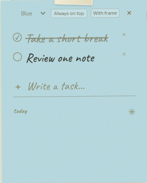

# SKYNI Sticky Tasks

**Your thoughts. Always visible.** Paper-like notes for quick tasks, available as a Web/PWA app and a Windows desktop beta.

[Open SKYNI Sticky Tasks Web/PWA](https://skyni-sticky.vercel.app/) · [Windows Beta 1 release](https://github.com/chistovd4d4-ship-it/SKYNI-Sticky-Tasks-Releases/releases/tag/v0.1.0-beta.1)

## Web/PWA

Open the app at [skyni-sticky.vercel.app](https://skyni-sticky.vercel.app/). It opens directly to the workspace and stores notes in IndexedDB in the current browser profile.

- Create, edit, complete, and delete stickers and tasks.
- Choose paper colors and switch between Russian and English.
- Export and import notes as JSON.
- Install it as a PWA when your browser offers installation.
- After the first successful online load, the app shell and required resources are cached for offline reload.

Browser notes are separate from Windows Desktop notes. Neither version synchronizes notes between devices. A regular browser popup cannot guarantee Always on Top; Document Picture-in-Picture is available only in supported browsers and contexts.

### Install the PWA

1. Open [the Web app](https://skyni-sticky.vercel.app/) and let it finish loading once while online.
2. In a supported browser, choose **Install app** from the address-bar install control or browser menu. On mobile, use **Add to Home Screen** if your browser offers it.
3. Open the installed app from your applications list or home screen. Offline startup is available after the initial successful load.

Install controls vary by browser and device. The web app remains usable in a normal browser tab when installation is not offered.

## Windows desktop beta

The [Windows Beta 1 release page](https://github.com/chistovd4d4-ship-it/SKYNI-Sticky-Tasks-Releases/releases/tag/v0.1.0-beta.1) is being finalized. Downloads and checksums will appear there when the release is published. It provides independent sticky-note windows with separate task lists.

- Choose yellow, pink, and blue paper; move and resize each note.
- Mark tasks complete, edit them, and scroll longer lists.
- Set Always on Top independently for each sticker.
- Keep notes on this Windows PC. No account or cloud synchronization is provided.

### Windows requirements

- 64-bit Windows. Windows 11 was used for the available desktop checks; Windows 10 and managed corporate devices still need user-side verification.
- Microsoft Edge WebView2 Evergreen Runtime. The portable app depends on it. The installer is configured for per-user installation and can bootstrap a missing runtime online; a fully offline installation requires WebView2 to be provisioned already.
- No administrator rights are intended for the per-user installer, but confirm this under your organization’s policy.

The beta executables are unsigned. Windows SmartScreen, Defender, or corporate endpoint controls may warn or block them. Do not bypass organizational security policy.

### Privacy, storage and removal

Web/PWA notes stay in IndexedDB in the browser profile where they were created. Desktop notes stay in the local Windows user profile. Neither version requires an account or provides cloud synchronization. Export important notes as JSON backups. Browser and Desktop storage are separate.

On some Windows 11 systems the app may not appear in **Installed Apps** or **Programs and Features**. The cause has not been established. If the standard list does not show it, use the app’s Settings uninstall action or the Start menu uninstall shortcut where available. Uninstalling with the app-data option disabled preserves notes.

## Screenshots

| Yellow | Pink | Blue |
| --- | --- | --- |
|  |  |  |

These screenshots show the real Windows application with demonstration notes.

## FAQ

**Is the Web/PWA app available?** Yes. Open [skyni-sticky.vercel.app](https://skyni-sticky.vercel.app/). It uses local browser storage and has no cross-device sync.

**Where will the Windows beta be available?** Downloads and SHA-256 checksums will be posted on the [Windows Beta 1 release page](https://github.com/chistovd4d4-ship-it/SKYNI-Sticky-Tasks-Releases/releases/tag/v0.1.0-beta.1) after publication.

**Will notes sync between Web and Windows?** No. Each version uses its own local storage.

**Does Portable mean fully self-contained?** No. The Windows executable requires WebView2 Evergreen Runtime.

**Will a web sticker always stay above every application?** A regular browser popup cannot promise this. Document Picture-in-Picture depends on browser support and system restrictions.

## Known limitations

- Windows 10, corporate-managed PCs, multi-monitor/DPI combinations, and missing-runtime installation need additional target-device acceptance.
- Unsigned Windows executables can trigger security warnings.
- Some Windows 11 configurations may omit the app from standard installed-app lists; use the in-app Settings action or Start menu uninstall shortcut.
- Web/PWA installation depends on browser and device support; offline use requires an initial successful online load.
- No macOS or iOS desktop package is available.

## Feedback

Ideas, suggestions, or feedback: [info.sticky@familylinck.com](mailto:info.sticky@familylinck.com).

Follow [SKYNI Labs on LinkedIn](https://www.linkedin.com/company/144806007/).

## Language

[Русская версия](README.ru.md)
