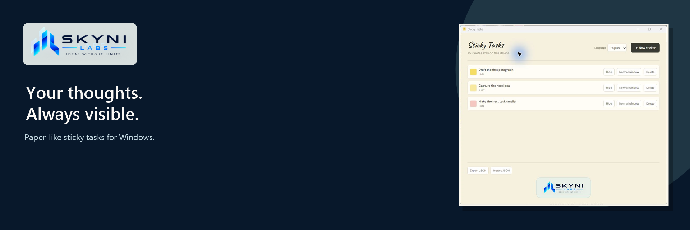
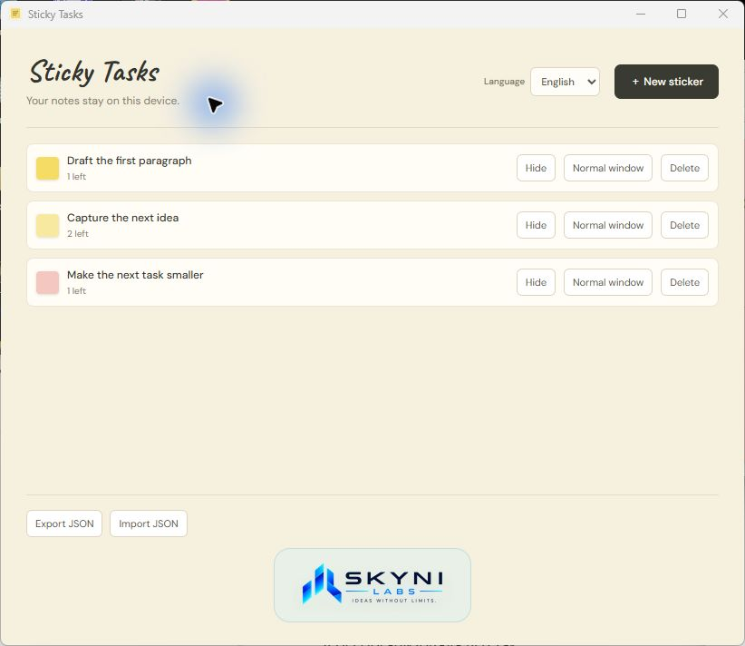
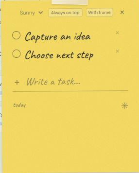
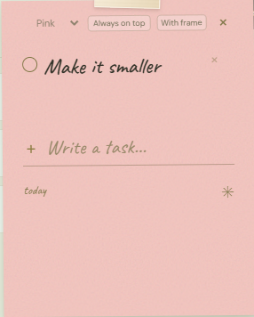

# SKYNI Sticky Tasks

**Your thoughts. Always visible.** A small Windows desktop app for paper-like sticky notes, independent windows, and quick task capture.

> **Free beta — v0.1.0-beta.1 is being prepared.** This public page is a product preview. No installer or executable is published yet.

## What it does

- Create independent sticky-note windows with separate task lists.
- Choose yellow, pink, or blue paper and resize or move each note.
- Mark tasks complete, edit them, and scroll longer lists.
- Set Always on Top independently for each sticker.
- Keep notes on this Windows PC. No account or cloud synchronization is provided.

## Windows requirements

- 64-bit Windows. Windows 11 was used for the available desktop checks; Windows 10 and managed corporate devices still need user-side verification.
- Microsoft Edge WebView2 Evergreen Runtime. The portable app depends on it. The installer is configured for per-user installation and can bootstrap a missing runtime online; a fully offline installation requires WebView2 to be provisioned already.
- No administrator rights are intended for the per-user installer, but confirm this under your organization’s policy.

The beta executables are unsigned. Windows SmartScreen, Defender, or corporate endpoint controls may warn or block them. Do not bypass organizational security policy. Wait for an approved download and verify its published SHA-256 before running it.

## Installation (when downloads are approved)

1. Download either the portable executable or the per-user setup from [Releases](https://github.com/chistovd4d4-ship-it/SKYNI-Sticky-Tasks-Releases/releases). The release page is not populated yet.
2. Verify the file against the SHA-256 values published with that release.
3. For portable use, place the EXE in a location you can write to and launch it. For setup, run the installer as your normal user.
4. If launch reports that WebView2 is unavailable, install/provision the official Evergreen Runtime through your IT-approved process.

## Privacy and storage

Desktop notes are stored locally in the current Windows user profile. The application does not require an account, send note contents to a SKYNI server, or synchronize them between devices. Back up important notes using the app’s JSON export. Browser Web/PWA storage, when offered, is separate from Desktop storage.

## Screenshots

| Yellow | Pink | Blue |
| --- | --- | --- |
|  |  |  |

These screenshots show the real Windows application with demonstration notes.

## FAQ

**Is this a stable release?** No. The first public package is planned as a beta and still needs final user acceptance on target Windows computers.

**Are notes backed up or synced online?** No. Notes stay local. Export a JSON backup yourself; there is no cloud sync.

**Does Portable mean fully self-contained?** No. It is a single app executable but requires Windows WebView2 Evergreen Runtime.

**Will it always stay above every application?** A sticker can request Always on Top using Windows window capabilities. Some system or enterprise-managed surfaces can still apply their own restrictions.

**Is Web/PWA available?** A public web address has not been approved or published yet.

## Known limitations

- Beta software; verify the release notes and checksums before use.
- Windows 10, corporate-managed PCs, multi-monitor/DPI combinations, and missing-runtime installation need additional target-device acceptance.
- Unsigned executables can trigger security warnings.
- No macOS or iOS package is available.
- No public web/PWA deployment or cross-device synchronization is available.

## Language

[Русская версия](README.ru.md)
