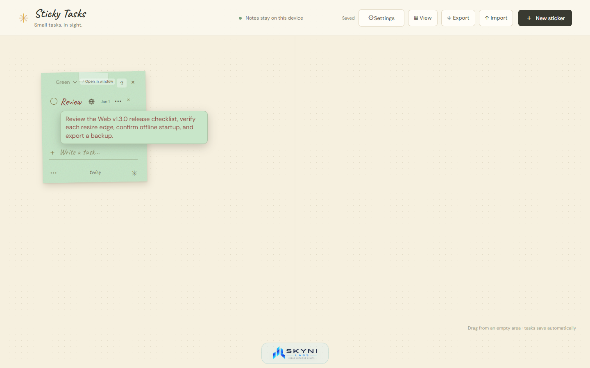
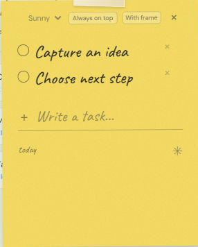
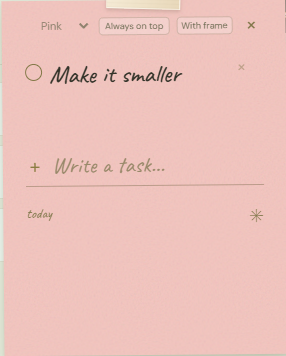

# SKYNI Sticky Tasks

**Ваши мысли. Всегда перед глазами.** Бумажные стикеры для быстрых дел — в Web/PWA и бета-версии для Windows.

[Открыть SKYNI Sticky Tasks Web/PWA](https://skyni-sticky.vercel.app/) · [Windows Beta 3](https://github.com/chistovd4d4-ship-it/SKYNI-Sticky-Tasks-Releases/releases/tag/v0.2.0-beta.3)

## Web/PWA

Откройте приложение по адресу [skyni-sticky.vercel.app](https://skyni-sticky.vercel.app/). Оно сразу показывает рабочее пространство и хранит заметки в IndexedDB текущего профиля браузера.

- Создавайте, редактируйте и удаляйте стикеры и задачи, отмечайте выполненное.
- Выбирайте цвет бумаги и переключайтесь между русским и английским.
- Экспортируйте и импортируйте заметки в JSON.
- Устанавливайте приложение как PWA, если браузер предлагает такую возможность.
- После первого успешного открытия с интернетом оболочка приложения и нужные ресурсы кэшируются для офлайн-перезагрузки.

### Web v1.4.0

- Переставляйте задачи внутри стикера перетаскиванием, клавиатурой или через меню. Порядок сохраняется после перезагрузки и в JSON экспорте/импорте.
- Сроки учитывают локальный календарь: задачи за 1–4 дня выделяются янтарным, а невыполненные задачи на сегодня и ранее — красным.
- Управляйте резервными копиями в настройках рядом с экспортом/импортом JSON. Перед заменой данных приложение автоматически создаёт проверенную локальную копию; у валидной копии отображаются дата и время, её можно скачать или восстановить после подтверждения.
- В настройках используется тонкая скруглённая полоса прокрутки для Light/Dark/System. Wheel, touch и клавиатурная прокрутка остаются доступными.
- Сохранены локальное хранилище, вложения, штатное обновление offline/PWA и отделённые стикеры.

### Web v1.3.1

- При наведении на край или угол resize показывает один фирменный направленный индикатор без дублирующего системного курсора. Механика resize и области захвата не изменены.

### Web v1.3.0

- Меняйте размер Web-стикера за любую из четырёх границ или углов. Размеры и координаты сохраняются локально и не меняются при временном изменении размера окна.
- Назначайте задаче локальный срок; просроченные незавершённые задачи отображаются красным.
- Выбирайте жёлтую, кремовую, розовую, голубую или зелёную бумагу. Если текст задачи не помещается, после короткой задержки появляется подсказка с полным текстом и переносом строк; она работает и в вынесенном стикере.
- Иконки Globe и Mail различают веб-ссылки и вложения писем. Маркеры задач, вложения `.msg`/`.eml` и URL из v1.2.0 сохранены.
- Переключайте RU/EN и Light/Dark/System. Содержимое задач остаётся в профиле этого браузера; данные IndexedDB и JSON-резервные копии Web v1.2.0 поддерживаются.

Заметки браузерной версии хранятся отдельно от Windows Desktop. Ни одна версия не синхронизирует заметки между устройствами. Обычное окно браузера не гарантирует режим «Поверх всех окон»; Document Picture-in-Picture работает только в поддерживаемых браузерах и контекстах.

### Установка PWA

1. Откройте [веб-приложение](https://skyni-sticky.vercel.app/) и дождитесь полной загрузки при подключённом интернете.
2. В поддерживаемом браузере выберите **Установить приложение** через значок установки в адресной строке или меню браузера. На мобильном устройстве используйте пункт **Добавить на главный экран**, если он доступен.
3. Запускайте PWA из списка приложений или с главного экрана. После первого успешного открытия доступен офлайн-запуск.

Возможность установки зависит от браузера и устройства. Если браузер её не предлагает, приложением можно пользоваться в обычной вкладке.

### Маркеры задач и вложения (Web v1.2.0)

- Добавляйте, меняйте и убирайте полупрозрачные маркеры строк задач: красный, жёлтый, зелёный, синий и фиолетовый.
- К задаче можно прикрепить одну HTTP/HTTPS-ссылку, ссылку на веб-почту или один файл `.msg` / `.eml` размером до 20 МБ.
- Файлы писем хранятся в IndexedDB текущего профиля браузера. Они не загружаются на серверы SKYNI и не включаются в аналитику. Вложения входят в JSON-экспорт и импорт.
- Ссылки открываются в новой вкладке. Браузер может скачать `.msg` / `.eml` для открытия почтовым приложением; автоматический запуск Outlook и перетаскивание писем напрямую из Outlook зависят от поддержки браузера.

## Бета-версия для Windows

Windows 0.2.0-beta.3 — текущая prerelease-версия с исправлениями приватности: [Setup](https://github.com/chistovd4d4-ship-it/SKYNI-Sticky-Tasks-Releases/releases/download/v0.2.0-beta.3/SKYNI-Sticky-Tasks-Setup.exe) · [Portable](https://github.com/chistovd4d4-ship-it/SKYNI-Sticky-Tasks-Releases/releases/download/v0.2.0-beta.3/SKYNI-Sticky-Tasks-Portable.exe) · [все файлы и заметки релиза](https://github.com/chistovd4d4-ship-it/SKYNI-Sticky-Tasks-Releases/releases/tag/v0.2.0-beta.3).

Beta 1 и Beta 2 помечены как superseded. Их страницы и файлы остаются доступными для восстановления и отката; для новой загрузки используйте Beta 3.

В Beta 2 добавлены перестановка задач перетаскиванием и клавиатурой, янтарное выделение приближающихся сроков и красное просроченных, пять цветовых маркеров задач, зелёные стикеры, URL- и почтовые вложения, изменение размеров отдельных окон, экспорт/импорт и проверенные локальные резервные копии. Web и Windows хранят данные отдельно; учётной записи и облачной синхронизации нет.

### Переход с Beta 1

В Beta 1 нет updater. Первый переход выполняется вручную. Закройте Beta 1, создайте и проверьте внешнюю резервную копию всего каталога данных приложения (workspace, настройки, геометрия окон, резервные копии и вложения), сохраните установщик Beta 1 для отката. Скачайте [Beta 3 Setup](https://github.com/chistovd4d4-ship-it/SKYNI-Sticky-Tasks-Releases/releases/download/v0.2.0-beta.3/SKYNI-Sticky-Tasks-Setup.exe), проверьте подписи релиза и `SHA256SUMS.txt`, затем запустите установку вручную. Сохраните существующий каталог данных и проверьте заметки после первого запуска. Не удаляйте резервную копию до подтверждения миграции. [Файлы для возврата к Beta 1](https://github.com/chistovd4d4-ship-it/SKYNI-Sticky-Tasks-Releases/releases/tag/v0.1.0-beta.1).

### Требования Windows и подписи

- 64-разрядная Windows и Microsoft Edge WebView2 Evergreen Runtime. Установщик может загрузить недостающий runtime; для Portable WebView2 должен быть установлен заранее.
- Setup имеет подпись Tauri Updater и Minisign, Portable — подпись Minisign. Для файлов релиза опубликованы контрольные суммы SHA-256. **Подписи Authenticode нет**; SmartScreen или средства защиты могут показать предупреждение. Не обходите корпоративную политику безопасности.
- Production manifest обновлений пока намеренно не активирован. Текущий endpoint не содержит manifest, поэтому Beta 2 не предлагается внутри приложения. Реальная установка updater и rollback не тестировались.

### Известные ограничения

- EML/MSG и прямой перенос из Outlook не проверялись при ручной приёмке; для этой беты пользователь принял их условно.
- Установка, перезапуск и откат updater не проверялись в изолированной Windows VM/Sandbox.
- Windows 10, управляемые устройства, нестандартный DPI и несколько мониторов требуют дополнительной проверки.

### Конфиденциальность, хранение и удаление

Заметки Web/PWA остаются в IndexedDB профиля браузера, где они были созданы. Desktop-заметки хранятся в локальном профиле Windows. Ни одной версии не нужна учётная запись, облачная синхронизация не предусмотрена. Для резервной копии экспортируйте заметки в JSON. Данные браузера и Desktop хранятся отдельно.

На Production-сайте Web аналитика Vercel собирает только просмотры основной страницы. Текст стикеров и задач, локальные ID, параметры URL и содержимое вложений не передаются. Основные функции и локальное хранилище продолжают работать, если аналитика недоступна.

На некоторых системах Windows 11 приложение может отсутствовать в стандартных списках **Установленные приложения** или **Программы и компоненты**. Причина не установлена. Если стандартный список его не показывает, используйте удаление в настройках приложения или ярлык деинсталляции в меню «Пуск», если он доступен. При удалении с выключенной опцией удаления данных заметки сохраняются.

## Скриншоты

| Жёлтый | Розовый | Голубой |
| --- | --- | --- |
|  |  |  |

Это реальные снимки приложения с демонстрационными заметками.

## Частые вопросы

**Доступна ли Web/PWA?** Да. Откройте [skyni-sticky.vercel.app](https://skyni-sticky.vercel.app/). Заметки хранятся локально в браузере; синхронизации между устройствами нет.

**Где скачать Windows-бету?** Скачайте [Windows Beta 3 Setup](https://github.com/chistovd4d4-ship-it/SKYNI-Sticky-Tasks-Releases/releases/download/v0.2.0-beta.3/SKYNI-Sticky-Tasks-Setup.exe), [Portable](https://github.com/chistovd4d4-ship-it/SKYNI-Sticky-Tasks-Releases/releases/download/v0.2.0-beta.3/SKYNI-Sticky-Tasks-Portable.exe) и остальные [файлы релиза](https://github.com/chistovd4d4-ship-it/SKYNI-Sticky-Tasks-Releases/releases/tag/v0.2.0-beta.3). Beta 1 и Beta 2 superseded, их файлы остаются доступны для отката. Production manifest updater пока не активен.

**Синхронизируются ли заметки между Web и Windows?** Нет. Каждая версия использует собственное локальное хранилище.

**Переносная версия Windows полностью автономна?** Нет. Исполняемому файлу нужен Windows WebView2 Evergreen Runtime.

**Будет ли веб-стикер всегда поверх всех окон?** Обычное окно браузера этого не гарантирует. Document Picture-in-Picture зависит от поддержки браузера и ограничений системы.

## Известные ограничения

- Windows 10, корпоративные компьютеры, сочетания нескольких мониторов/DPI и установка при отсутствии WebView2 требуют дополнительной проверки на целевом устройстве.
- Неподписанные исполняемые файлы Windows могут вызывать предупреждения безопасности.
- В некоторых конфигурациях Windows 11 приложение может отсутствовать в стандартных списках установленных программ; используйте настройки приложения или ярлык удаления в меню «Пуск».
- Установка Web/PWA зависит от браузера и устройства; для офлайн-работы требуется первое успешное открытие с интернетом.
- Desktop-версии для macOS и iOS нет.

## Обратная связь

Идеи, пожелания и замечания: [создайте issue на GitHub](https://github.com/chistovd4d4-ship-it/SKYNI-Sticky-Tasks-Releases/issues).

Следите за [SKYNI Labs в LinkedIn](https://www.linkedin.com/company/144806007/).

## Язык

[English version](README.md)
