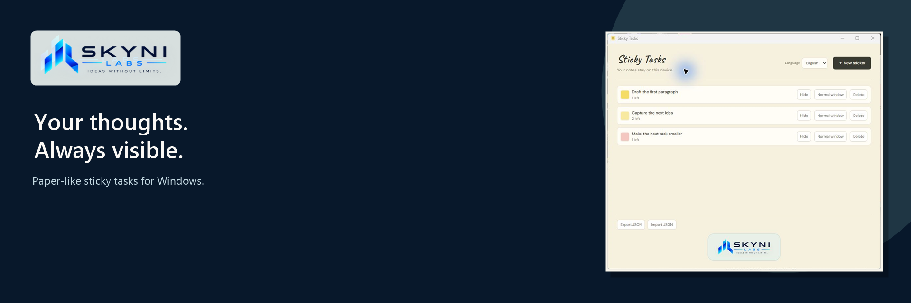
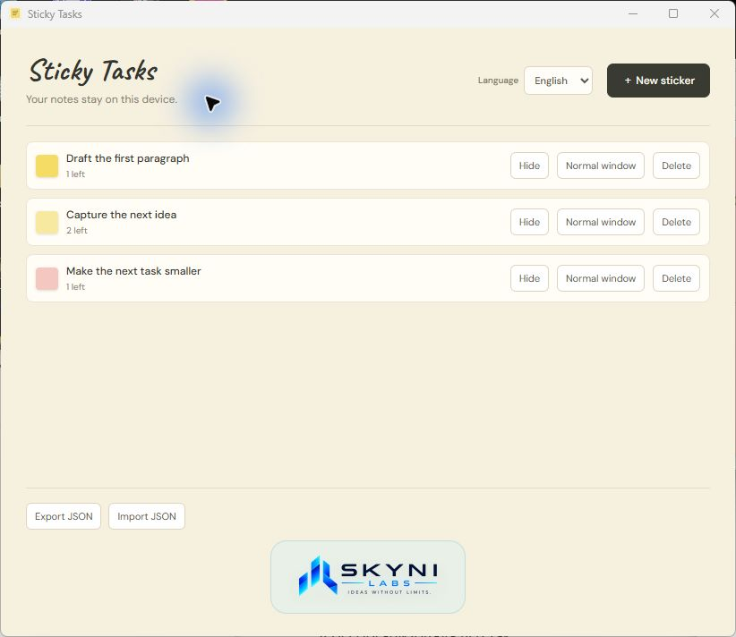
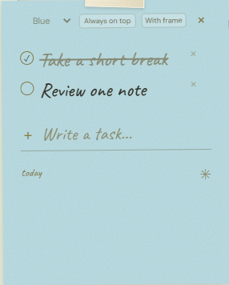

# SKYNI Sticky Tasks

**Ваши мысли. Всегда перед глазами.** Бумажные стикеры для быстрых дел — в Web/PWA и бета-версии для Windows.

[Открыть SKYNI Sticky Tasks Web/PWA](https://skyni-sticky.vercel.app/) · [Windows Beta 1](https://github.com/chistovd4d4-ship-it/SKYNI-Sticky-Tasks-Releases/releases/tag/v0.1.0-beta.1)

## Web/PWA

Откройте приложение по адресу [skyni-sticky.vercel.app](https://skyni-sticky.vercel.app/). Оно сразу показывает рабочее пространство и хранит заметки в IndexedDB текущего профиля браузера.

- Создавайте, редактируйте и удаляйте стикеры и задачи, отмечайте выполненное.
- Выбирайте цвет бумаги и переключайтесь между русским и английским.
- Экспортируйте и импортируйте заметки в JSON.
- Устанавливайте приложение как PWA, если браузер предлагает такую возможность.
- После первого успешного открытия с интернетом оболочка приложения и нужные ресурсы кэшируются для офлайн-перезагрузки.

Заметки браузерной версии хранятся отдельно от Windows Desktop. Ни одна версия не синхронизирует заметки между устройствами. Обычное окно браузера не гарантирует режим «Поверх всех окон»; Document Picture-in-Picture работает только в поддерживаемых браузерах и контекстах.

### Установка PWA

1. Откройте [веб-приложение](https://skyni-sticky.vercel.app/) и дождитесь полной загрузки при подключённом интернете.
2. В поддерживаемом браузере выберите **Установить приложение** через значок установки в адресной строке или меню браузера. На мобильном устройстве используйте пункт **Добавить на главный экран**, если он доступен.
3. Запускайте PWA из списка приложений или с главного экрана. После первого успешного открытия доступен офлайн-запуск.

Возможность установки зависит от браузера и устройства. Если браузер её не предлагает, приложением можно пользоваться в обычной вкладке.

## Бета-версия для Windows

Windows Beta 1 распространяется на странице [релиза Windows](https://github.com/chistovd4d4-ship-it/SKYNI-Sticky-Tasks-Releases/releases/tag/v0.1.0-beta.1). Desktop-версия создаёт независимые окна-стикеры с отдельными списками дел.

- Жёлтая, розовая и голубая бумага; каждый стикер можно перемещать и менять его размер.
- Отметка выполненных дел, редактирование и прокрутка длинного списка.
- Индивидуальный режим «Поверх всех окон» для каждого стикера.
- Заметки хранятся на этом компьютере. Учётная запись и облачная синхронизация не предусмотрены.

### Требования Windows

- 64-разрядная Windows. Доступные проверки приложения проводились на Windows 11; Windows 10 и корпоративные компьютеры ещё требуют проверки пользователем.
- Microsoft Edge WebView2 Evergreen Runtime. Переносимая версия зависит от него. Установщик рассчитан на установку для текущего пользователя и может загрузить недостающий runtime через интернет; для полностью автономной установки WebView2 должен быть заранее предоставлен.
- Для установщика не предполагаются права администратора, однако это зависит от политик вашей организации.

Бета-файлы не подписаны. SmartScreen, Defender или корпоративная защита могут показать предупреждение или заблокировать запуск. Не обходите правила организации.

### Конфиденциальность, хранение и удаление

Заметки Web/PWA остаются в IndexedDB профиля браузера, где они были созданы. Desktop-заметки хранятся в локальном профиле Windows. Ни одной версии не нужна учётная запись, облачная синхронизация не предусмотрена. Для резервной копии экспортируйте заметки в JSON. Данные браузера и Desktop хранятся отдельно.

На некоторых системах Windows 11 приложение может отсутствовать в стандартных списках **Установленные приложения** или **Программы и компоненты**. Причина не установлена. Если стандартный список его не показывает, используйте удаление в настройках приложения или ярлык деинсталляции в меню «Пуск», если он доступен. При удалении с выключенной опцией удаления данных заметки сохраняются.

## Скриншоты

| Жёлтый | Розовый | Голубой |
| --- | --- | --- |
|  |  |  |

Это реальные снимки приложения с демонстрационными заметками.

## Частые вопросы

**Доступна ли Web/PWA?** Да. Откройте [skyni-sticky.vercel.app](https://skyni-sticky.vercel.app/). Заметки хранятся локально в браузере; синхронизации между устройствами нет.

**Где скачать Windows-бету?** Файлы и контрольные суммы SHA-256 находятся в [релизе Windows Beta 1](https://github.com/chistovd4d4-ship-it/SKYNI-Sticky-Tasks-Releases/releases/tag/v0.1.0-beta.1).

**Синхронизируются ли заметки между Web и Windows?** Нет. Каждая версия использует собственное локальное хранилище.

**Переносная версия Windows полностью автономна?** Нет. Исполняемому файлу нужен Windows WebView2 Evergreen Runtime.

**Будет ли веб-стикер всегда поверх всех окон?** Обычное окно браузера этого не гарантирует. Document Picture-in-Picture зависит от поддержки браузера и ограничений системы.

## Известные ограничения

- Windows 10, корпоративные компьютеры, сочетания нескольких мониторов/DPI и установка при отсутствии WebView2 требуют дополнительной проверки на целевом устройстве.
- Неподписанные исполняемые файлы Windows могут вызывать предупреждения безопасности.
- В некоторых конфигурациях Windows 11 приложение может отсутствовать в стандартных списках установленных программ; используйте настройки приложения или ярлык удаления в меню «Пуск».
- Установка Web/PWA зависит от браузера и устройства; для офлайн-работы требуется первое успешное открытие с интернетом.
- Desktop-версии для macOS и iOS нет.

## Обратная связь

Идеи, пожелания и замечания: [info.sticky@familylinck.com](mailto:info.sticky@familylinck.com).

Следите за [SKYNI Labs в LinkedIn](https://www.linkedin.com/company/144806007/).

## Язык

[English version](README.md)
